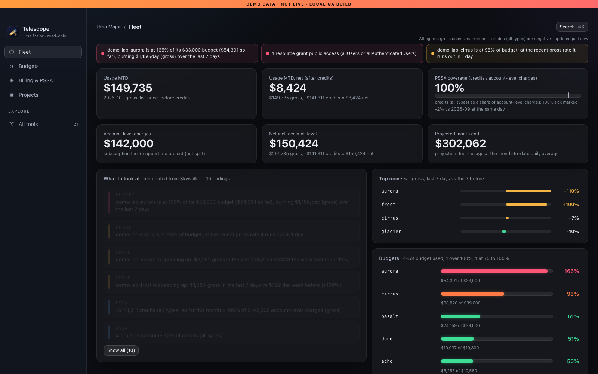
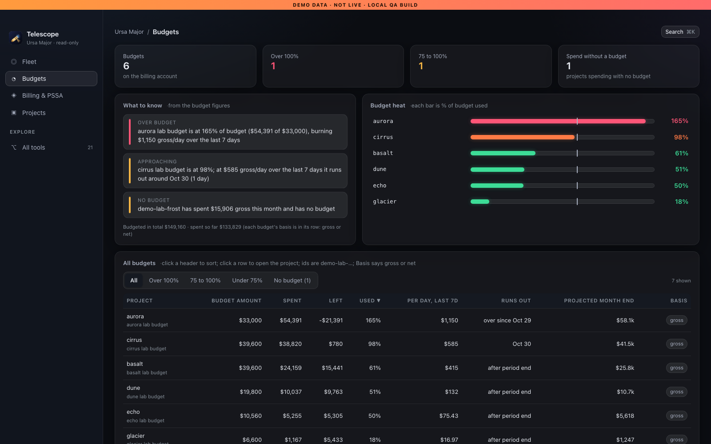
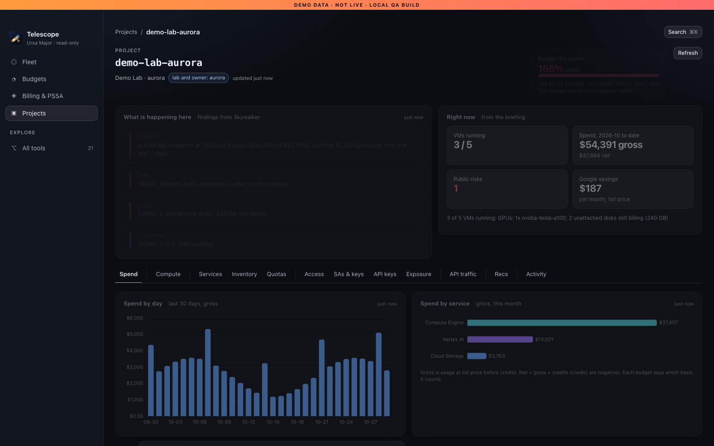
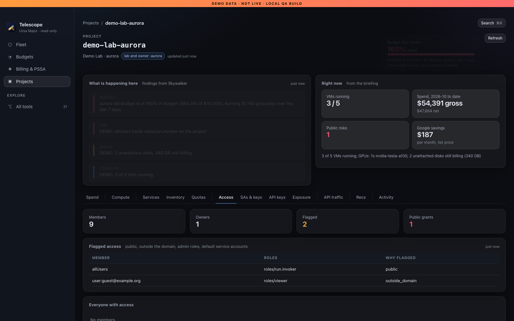
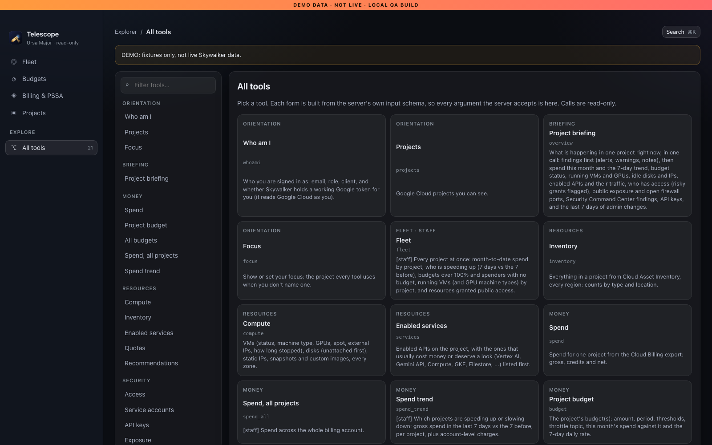
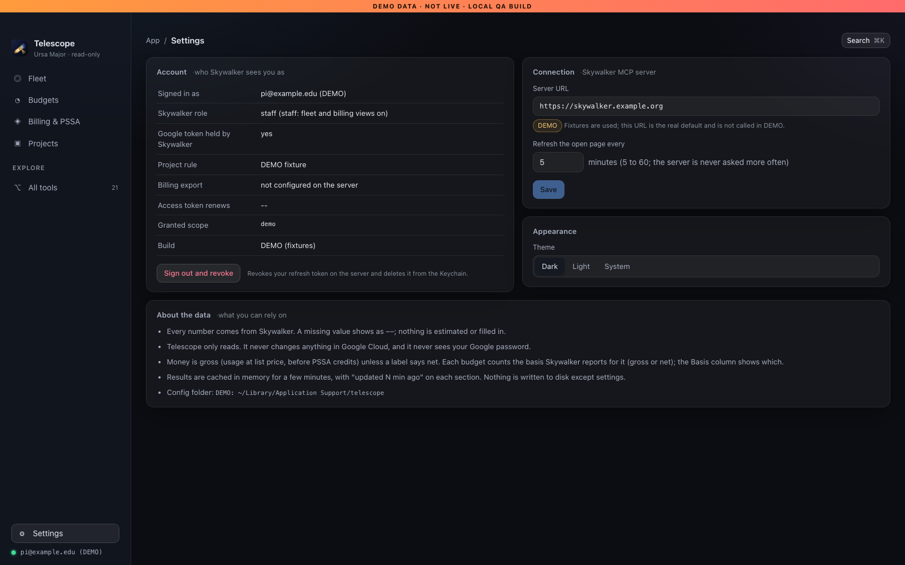

# Telescope

[](https://doi.org/10.5281/zenodo.23755871)

[](https://github.com/charles-forsyth/telescope/actions/workflows/ci.yml)
[](https://opensource.org/licenses/MIT)

**Telescope** is a fast, read-only desktop viewer for a fleet of Google Cloud research projects. Powered by the public [Skywalker](https://github.com/charles-forsyth/Skywalker) MCP server, Telescope acts on behalf of the signed-in researcher or research computing administrator, ensuring you see strictly what your Google Cloud credentials authorize.

Built with **Tauri 2**, **Svelte 5**, **TypeScript**, and **Apache ECharts**, Telescope provides instant visibility into spend, budgets, compute resources, access policies, exposure, quotas, and admin activity across research labs.

Developed by Charles Forsyth at University of California, Riverside (Research Computing).

---

## Screenshots

### Fleet Overview


### Budgets & Burn Rate


### Project Spend Details


### Access & Security Auditing


### MCP Tool Explorer & Settings
<p align="center">
  
  
</p>

---

## Features

- **Fleet Dashboard**: Month-to-date gross and net spend across all research projects, burn-rate projections, top movers (7-day trend vs previous 7 days), budget alerts, and automated findings from Skywalker.
- **Budget Tracking**: Real-time budget consumption, projected exhaustion dates, and alerts for unbudgeted project spend.
- **Project Deep-Dive (12 Views)**: Spend breakdowns by service/SKU, compute instances and GPU allocations, enabled APIs, Asset Inventory, IAM access audits, service accounts and user-managed keys, API keys, public exposure vectors, quota usage, Google Cloud Recommender cost savings, and admin activity audit trails.
- **MCP Tool Explorer**: Interactive catalog of all 21 Skywalker MCP tools with dynamic forms generated directly from tool JSON schemas.
- **Command Palette (`⌘K`)**: Quick fuzzy jump to any project, tool, or view.

---

## Security Model

Telescope is engineered with a strict read-only security posture:

1. **OAuth 2.1 with PKCE (S256)**: Implements standard RFC 7636 and RFC 8414 authorization against the Skywalker server. Authentication is initiated with dynamic client registration and loopback redirect.
2. **Keyring Token Storage**: OAuth tokens reside exclusively in the operating system's native secure credential store (macOS Keychain via `apple-native` keyring, Windows Credential Manager via `windows-native`). Tokens are **never written to plain text config files** and **never exposed to the webview DOM**.
3. **Intent-Gated Sign-In**: To prevent clickjacking or automated authorization from accidental focus, sign-in requires two deliberate physical clicks ("Sign in with Google" followed by "Open browser" in a confirmation dialog).
4. **Completely Read-Only**: Telescope issues only inspection calls (`tools/call` for query tools). It has no write permissions, cannot create or modify Google Cloud infrastructure, and cannot change billing configurations.
5. **Rate-Limit & Cache Honesty**: In-memory response caching prevents redundant calls; concurrency is limited to at most 3 simultaneous queries; and HTTP 429 rate limits strictly respect `Retry-After` headers with exponential backoff.
6. **Token Revocation on Sign-Out**: Signing out performs RFC 7009 token revocation on the server before clearing tokens from the OS Keychain.

---

## Installation

### macOS (Apple Silicon & Intel Universal DMG)

1. Download the latest `Telescope-0.1.0-mac-universal.dmg` from the [Releases](https://github.com/charles-forsyth/telescope/releases) page.
2. Open the DMG and drag **Telescope** into your **Applications** folder.
3. Because the release DMG is ad-hoc signed, right-click (or Control-click) **Telescope.app** in Applications and select **Open**, then confirm **Open** in the macOS dialog.
4. (Optional) If macOS displays a quarantine prompt, run:
   ```bash
   xattr -dr com.apple.quarantine /Applications/Telescope.app
   ```

---

## Building from Source

### Prerequisites

- [Node.js](https://nodejs.org/) (v22 LTS or newer) and `npm`
- [Rust](https://www.rust-lang.org/) stable toolchain
- macOS development tools (Xcode Command Line Tools)

### Build Commands

```bash
# Clone repository
git clone https://github.com/charles-forsyth/telescope.git
cd telescope

# Install dependencies
npm ci

# Run test suites
npm test                # 89 vitest unit tests
cd src-tauri && cargo test && cd ..  # 37 Rust unit tests

# Build frontend & Tauri desktop app
npm run build
npm run tauri build -- --target universal-apple-darwin --bundles app,dmg
```

### Demo Mode

Telescope includes a self-contained demo mode backed by fictional research lab fixtures (used for QA and screenshot generation):

```bash
TELESCOPE_DEMO=1 npm run build -- --outDir dist-demo
python3 -m http.server 1420 --directory dist-demo
```
The UI displays a persistent `DEMO DATA` banner across all screens when compiled in demo mode.

---

## Citation

If you use Telescope or Skywalker in your research or institutional cloud operations, please cite:

```bibtex
@software{forsyth2026telescope,
  author       = {Forsyth, Charles E. III},
  title        = {Telescope: a read-only desktop viewer for a research cloud fleet},
  year         = {2026},
  publisher    = {Zenodo},
  version      = {0.1.0},
  url          = {https://github.com/charles-forsyth/telescope}
}
```

---

## License

Released under the [MIT License](LICENSE). Copyright (c) 2026 Charles Forsyth.
